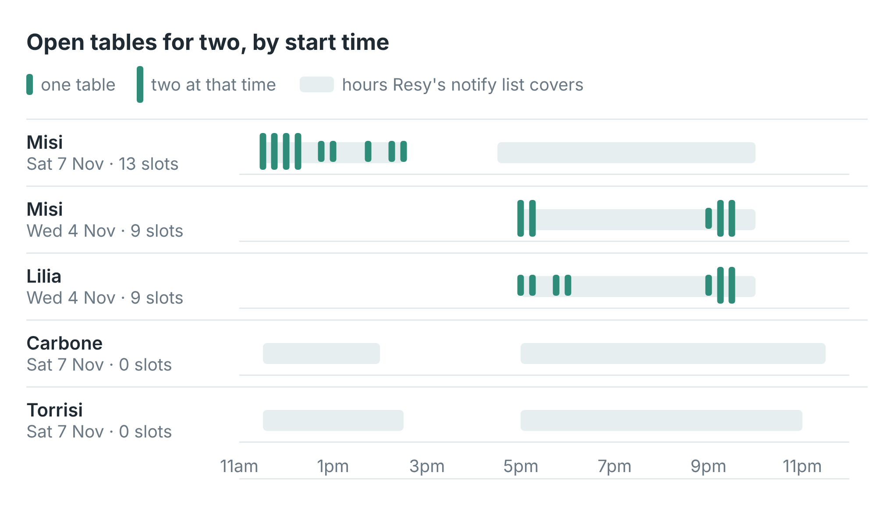

# Resy table finder: which nights a booked-out restaurant has a table

Give it the Resy URLs of the restaurants you can't get into and get Resy's own
booking calendar for each, for your party size: every day marked `available`,
`sold-out` or `closed`. The script prints each restaurant's open days, best
first, and writes every day of every calendar to a CSV. Run it on a schedule
and a new open date is a cancellation.

These scripts call [Resy Scraper](https://apify.com/simple.actor/resy-availability)
on Apify. No Resy account, no login and no browser is needed.


The write-up, with a real run on eight New York restaurants, is
[How to get a table at a booked-out New York restaurant on Resy](https://simple-actor.github.io/get-table-booked-out-restaurant-resy-new-york/)

## Run it

You need an [Apify](https://apify.com) account and its API token, from
Console → Settings → API & Integrations.

**Node** (20 or newer):

```bash
cd node
npm install
APIFY_TOKEN=your_token node open-tables.mjs https://resy.com/cities/new-york-ny/venues/lilia https://resy.com/cities/new-york-ny/venues/carbone
```

**Python** (3.10 or newer):

```bash
cd python
python -m venv .venv && . .venv/bin/activate
pip install -r requirements.txt
APIFY_TOKEN=your_token python open_tables.py https://resy.com/cities/new-york-ny/venues/lilia https://resy.com/cities/new-york-ny/venues/carbone
```

The arguments are Resy venue URLs, the address of the restaurant's page on
resy.com. `PARTY=4` changes the party size (default 2) and `DAYS=14` the window
(default 30). The output, for Lilia, I Sodi, Carbone and Torrisi on 31 October 2026:

```
 18 of 27 days  Lilia  first 2026-10-31
  1 of 13 days  I Sodi  first 2026-10-31
  0 of 30 days  Carbone
  0 of 30 days  Torrisi
100 days written to calendar.csv
```

A URL Resy doesn't know leaves no row at all, and the scripts print
`no row for <url>`: either the address is wrong or the restaurant doesn't
take bookings on Resy.

## What a row looks like

[`sample-output.json`](sample-output.json) holds four real rows: Lilia,
Carbone and I Sodi with the 30-day calendar, and Misi with its open tables
for Saturday 7 November (the booking `token` on each slot is left out).

The fields you will use most:

| Field | What it holds |
|---|---|
| `name`, `canonicalUrl` | The restaurant, and its Resy URL |
| `availableDates`, `availableDateCount` | Days in the window with a table for your party size |
| `calendar` | Every day: `date`, `reservation` (`available`, `sold-out`, `closed`), `walkIn` |
| `slots` | With `includeAvailability` and a `date`: every open table, with `startTime`, `type`, `turnTimeSeconds` |
| `earliestSlot`, `latestSlot`, `slotCount` | The day's open tables in short |
| `notifyAvailable`, `notifyWindows` | Whether Resy will take you on its notify list that day, and for which hours |
| `googlePlaceId`, `phone`, `website`, `rating` | The restaurant record, on every row |
| `scrapedAt` | When the row was read; availability moves by the minute |

An `available` day can be lunch only, or 5pm and 9pm. For a time you can
actually use, run it again with `includeAvailability: true` and
`date: "YYYY-MM-DD"` and read the `slots`:



## Cost

$0.001 for each restaurant row returned, $1.00 per 1,000, and $0.98 per 1,000
on Apify's Business plan and up. A URL that leaves no row costs nothing. The
30-day calendar for eight restaurants cost $0.008.

## Limits

- **`maxItems` caps the URL list.** It defaults to 3; the scripts set it to
  the number of URLs.
- **About 30 days ahead.** Resy returned at most 30 days of calendar, and
  fewer for restaurants with a shorter one (6 days at one of the eight).
- **One party size a run.** A table for two and a table for four are
  different calendars.
- **It reads, it doesn't book.** Book in Resy's own app.
